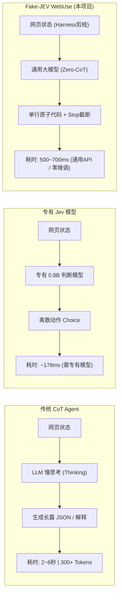
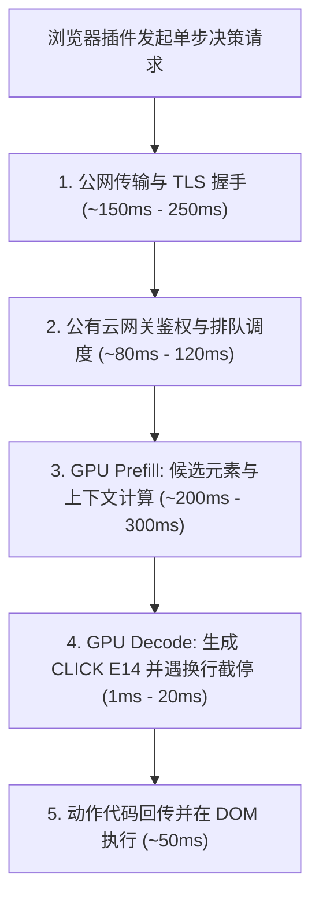
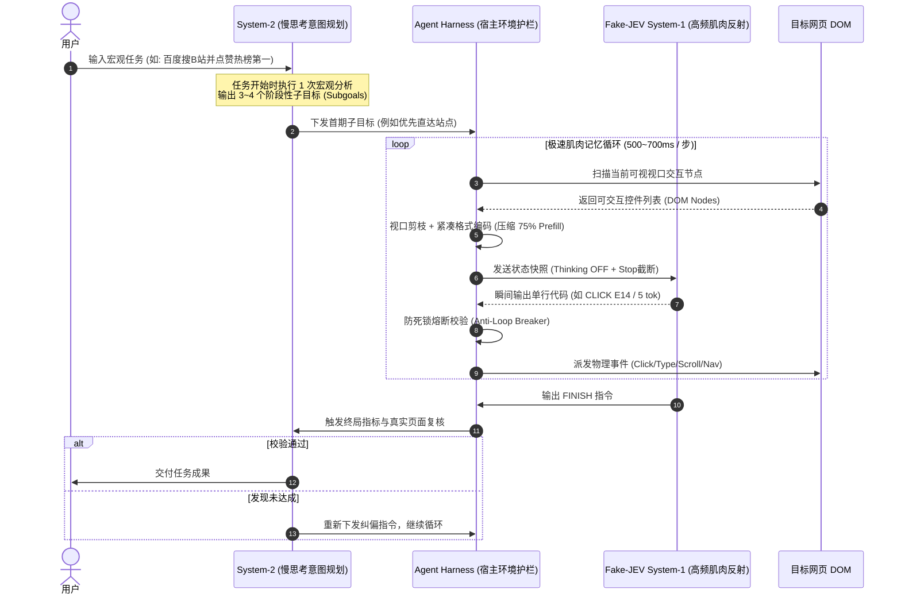
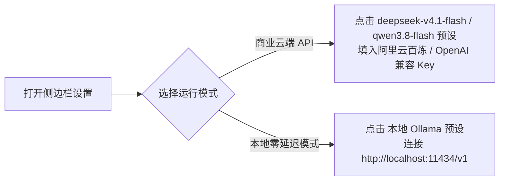

# Fake-JEV WebUse

<p align="center">
  <strong>基于通用大模型 + 外部工程护栏，复现 Jev “只做决策、不生成文本” 的极速浏览器自动化实验</strong>
</p>

<p align="center">
  
  
  
  
</p>

---

## 1. 核心背景：Jev 带来了什么新思路？

在传统的大模型浏览器自动化（Browser Agent）中，通常采用标准的自回归 LLM 或 VLM。模型在每一步操作前，都会输出几百字的思考过程（Chain-of-Thought）或者冗长的 JSON：
- **单步耗时极长**：模型逐 Token 吐字，单步耗时高达 2 ~ 6 秒；
- **接口成本高昂**：充满了解释性废话与长篇格式样板代码；
- **脆弱易死循环**：长文本生成极易产生格式幻觉与逃逸。

业界先锋 **TypeSafe 推出了 Jev 判断模型（System One Model）**，带来了一个颠覆性的思路：
> **模型不写文字、不闲聊、不输出解释，只做结构化的快速决策。**

在像 `jev-ultrafast` 这类架构中，Jev 接收结构化 DOM 状态与选项，直接输出选择（如 `CLICK [7]`），单步决策中位延迟可达 178ms，将传统 Agent 拖沓的多步骤任务压缩到了秒级完成。

---

## 2. 本项目探索：Fake-JEV 的技术假设

Jev 证明了**“纯做决策、消除长文本生成”**是浏览器 Agent 提速降本的正解。但目前专有决策模型通常为特定微调产物或闭源服务。

**Fake-JEV WebUse** 提出了一个明确的工程假设：
> **我们真的必须依赖专有微调决策模型吗？通用大模型（如 DeepSeek-Flash、Qwen-Flash）是否也能直接以 Jev 的方式工作？**

从模型机理来看，专有微调的核心作用在于**把输出空间强行约束为原子代码**。既然如此，如果我们完全**不修改模型权重、不进行昂贵微调**，而是借助**外部工程护栏（Agent Harness）**：
1. **API 级彻底关闭思考（Thinking Budget = 0）**；
2. **严格单行指令语法 + 物理换行截停（Stop Sequences）**；
3. **环境感知剪枝与防死锁熔断沙箱**；

通用大模型是否能直接化身为高频决策引擎？

### 实验结论
**完全可行。** 通用 Flash 大模型在外部强约束下，生成阶段仅需输出 1~5 个 Token（耗时仅 **1ms ~ 20ms**），单步端到端在公网商业 API 下稳定在 **500ms ~ 700ms**。同时，依托通用大模型千亿级的语义理解力，在复杂自然语言意图理解、复杂表单语义消解上显著超越了专用小模型。

---

## 3. 技术范式对比矩阵



| 对比维度 | 传统 CoT 浏览器 Agent | 专有 Jev 决策模型 (Native Jev) | Fake-JEV WebUse (本项目) |
| :--- | :--- | :--- | :--- |
| **底层模型类型** | 通用生成式 LLM / VLM | 专有判别式 / SFT 小模型 | **通用商用大模型 (DeepSeek / Qwen / Gemini)** |
| **单步模型行为** | 生成完整思维链 + 长 JSON | 结构化概率评估 / 离散选择 | **关闭思考，仅生成单行指令 (1~5 Tokens)** |
| **解码截停机制** | 等待模型完整吐完 | 分类头单次输出 | **注入 `\n` 物理截停，瞬间终止传输** |
| **端到端实测延迟** | 2000ms ~ 7000ms | 70ms ~ 200ms (局域网/端侧) | **500ms ~ 700ms (公网商业 API 实测)** |
| **模型纯解码耗时** | 1500ms ~ 5000ms | 5ms ~ 20ms | **1ms ~ 20ms (单步 3~7 Tokens)** |
| **泛化理解天花板** | 高（但被生成延迟拖慢） | 受限于小模型参数规模 | **高（继承通用大模型原生理解力）** |
| **部署与适配成本** | 低 | 高（需训练/微调/部署专用模型） | **零成本（修改 Prompt/Harness 即时生效）** |

---

## 4. 性能基准与全链路耗时拆解

在普通家用宽带（公网）环境下，直接调用阿里云百炼商业 API（`deepseek-v4.1-flash`）的端到端单步全链路耗时分布：



> **关于延迟的客观说明**：  
> 社区 JEV 测出的 70ms ~ 178ms 中位延迟，是建立在 **端侧本地部署（Localhost）或同机房专线 VPC** 前提下的（公网物理 RTT = 0，无公有云排队）。而在真实家用公网直接调用云端 API 的场景下，**500ms ~ 700ms 是包含物理网络往返与云端排队在内的真实端到端体感**。

---

## 5. 架构设计：认知双系统协同 (Dual-System)

为了在保持微观高频反射速度的同时，不错失长流程全局任务目标，Fake-JEV 采用双系统解耦设计：



---

## 6. 支持的原子动作语法 (11-Tool Agent Grammar)

Fake-JEV 严格禁止模型输出自然语言解释，仅允许输出以下单行标准指令：

| 指令语法 | 功能说明 | 典型示例 |
| :--- | :--- | :--- |
| `CLICK <id>` | 点击可视区域内的指定元素 | `CLICK E14` |
| `TYPE <id>:<value>` | 在输入框填入内容并回车提交 | `TYPE E13:哔哩哔哩` |
| `CLEAR_TYPE <id>:<value>` | 先清空输入框再填入新内容 | `CLEAR_TYPE E13:北京机票` |
| `GOTO <url>` | 原生标签页直达指定网址 | `GOTO https://www.bilibili.com` |
| `SCROLL <DOWN/UP>` | 视口平滑滚动寻找新元素 | `SCROLL DOWN` |
| `PRESS <key>` | 触发键盘核心按键 | `PRESS KEY_ENTER` |
| `HOVER <id>` | 鼠标悬停唤起悬浮菜单 | `HOVER E8` |
| `WAIT <seconds>` | 显式等待动态异步数据渲染 | `WAIT 2` |
| `CLOSE_MODAL` | 智能清退页面弹出的遮罩或登录窗 | `CLOSE_MODAL` |
| `GO_BACK` | 浏览器回退上一页 | `GO_BACK` |
| `FINISH <message>` | 确认阶段或全局目标已达成 | `FINISH 点赞操作已确认完成` |

---

## 7. 快速开始与安装指南

### 1. 安装扩展
1. 将本仓库克隆至本地：
   ```bash
   git clone https://github.com/relliex/fake_jev_webuse.git
   ```
2. 打开 Google Chrome 浏览器，地址栏输入 `chrome://extensions/`；
3. 开启右上角 **“开发者模式”**；
4. 点击左上角 **【加载已解压的扩展程序】**，选择本仓库中的 `extension` 目录。

### 2. 配置推理模型
点击 Chrome 右上角拼图图标，打开 **Fake-JEV** 侧边栏，点击右上角 **⚙️ 设置**：



- **云端模式（推荐）**：支持阿里云百炼 `deepseek-v4.1-flash`、`qwen3.8-flash`、DeepSeek 官方 API 等 OpenAI 兼容格式；
- **本地模式（0 网络时延）**：支持通过 Ollama / vLLM 本地运行 `qwen2.5:1.5b`，体验 70ms~150ms 纯本地推理。

### 3. 执行任务
在任务框输入自然语言指令（例如：“*在百度搜索哔哩哔哩并进入热榜第一视频点赞*”），点击 **⚡ 极速运行**。

---

## 8. 技术护栏实现细节 (Harness Details)

- **单标签页锁定（Single-Tab Enforcement）**：拦截并抹平所有 `target="_blank"` 与 `window.open`，强制操作限制在当前 Tab 内，避免多标签页失控；
- **DOM 穿透（Shadow DOM Traversal）**：递归遍历复杂现代化播放器（如 B站视频控件）内部的 open Shadow Root；
- **防死锁熔断器（Anti-Loop Circuit Breaker）**：动态追踪操作历史，连续对同一目标无效操作时强制剔除候选槽位，自动寻找替代路径；
- **全透明审计记录（Audit Logger）**：侧边栏内置审计弹窗，可实时回放与导出每一步发给模型的无删减 Prompt、Token 耗时以及原始 API 响应。

---

## License

本项目基于 [MIT License](LICENSE) 开源。
